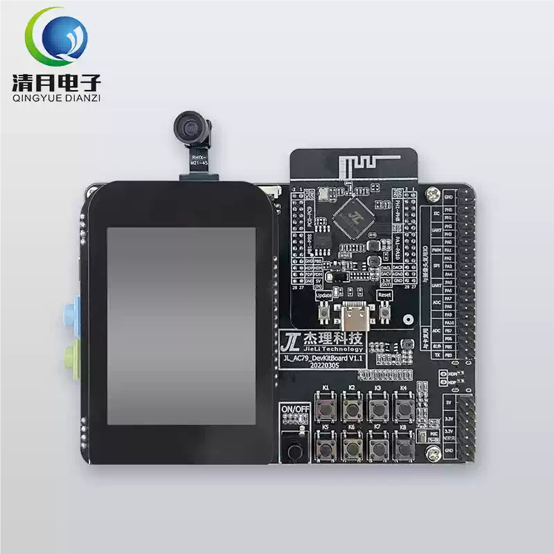
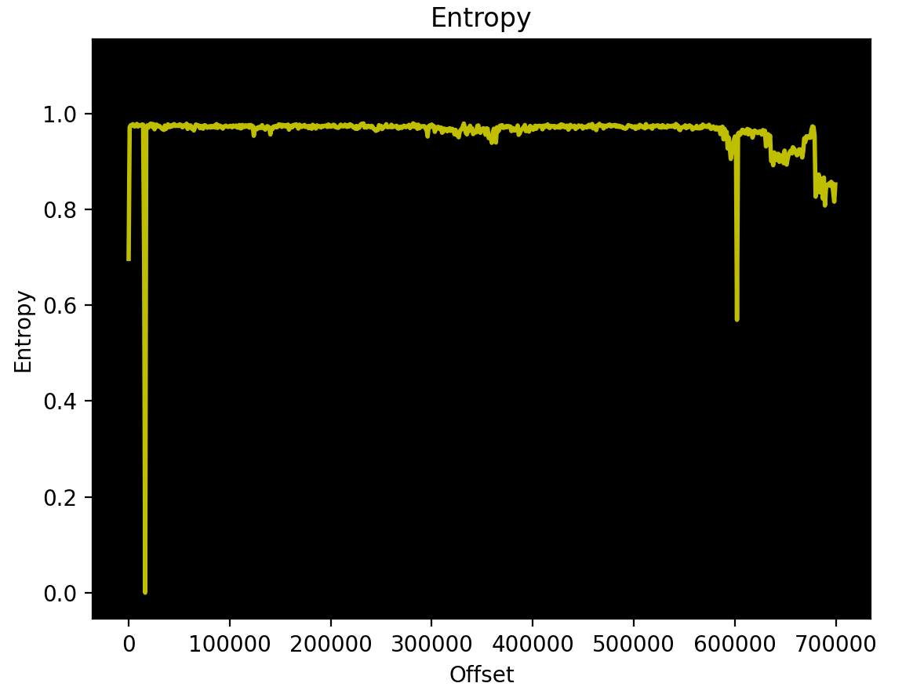

# M-VAVE FM1 Hardware Architecture, Protocol & Reverse Engineering Reference

Technical reference and reverse-engineering findings for the **M-VAVE FM1** synthesizer (powered by the **JieLi AC791N** processor / WL82 series) — covering hardware analysis, bootloader memory maps, OTA MIDI SysEx protocol specifications, binary offsets, recovery vectors, and disassembly tooling.

> Part of the [M-VAVE FM1 Resource Hub](README.md).

---

## 1. Hardware & Device Ecosystem Overview

### 1.1. Target Device & Processor
* **Target Device:** **M-VAVE FM1** (FM Synthesizer / MIDI Controller).
* **Processor SoC:** **JieLi AC791N Series** (WL82 family, dual-core 32-bit `pi32v2` RISC core with FPU, DC–320 MHz, integrated Wi-Fi 802.11b/g/n and Bluetooth 2.1+EDR / BLE 5.3).
* **Exact IC Model on PCB:** **JieLi AC7911B** (marking `JL C156211-11A-B` on PCB, package **QFN-48**, 6 × 6 mm, 0.4 mm pitch, 12 pins per side = 48 pins + center exposed ground pad `VSS`, internal 4M×16-bit / 8 MB SDRAM in `AC7911BB` or 2 MB in `AC7911BA`, and internal SiP-packaged 1 MB / 8 Mbit SPI NOR Flash — Puya P25Q80H, JEDEC `0x856014`, routed via the SFC controller on `PD0`–`PD6`).
* **Official Development Board:** **JL_AC79_DevKit V1.0** (AC791N evaluation kit).
  * [JL_AC79_DevKit V1.0 Official Documentation](https://doc.zh-jieli.com/AC79/zh-cn/release_v1.0.3/board_description/board_overview/index.html)
  * Note: In retail/marketplace listings, this devboard has been found available for purchase primarily on **Taobao**.
  
  

* **Datasheets & Reference Schematics:**
  * Official repository upstream: [amitv87/fw-AC79_AIoT_SDK doc/datasheet](https://github.com/amitv87/fw-AC79_AIoT_SDK/tree/release/AC79NN_SDK_V1.2.0/doc/datasheet)
  * **Primary Chip Datasheet:** [AC7911B Datasheet V1.3 (QFN-48)](https://github.com/amitv87/fw-AC79_AIoT_SDK/blob/release/AC79NN_SDK_V1.2.0/doc/datasheet/AC791N%E8%A7%84%E6%A0%BC%E4%B9%A6/datasheet/AC7911B_Datasheet_V1.3_20230303.pdf) — Matches the exact 48-pin package of the FM-1 board.
  * **Reference Schematics:** [AC791N Schematics (GitHub)](https://github.com/amitv87/fw-AC79_AIoT_SDK/tree/release/AC79NN_SDK_V1.2.0/doc/datasheet/AC791N%E8%A7%84%E6%A0%BC%E4%B9%A6/schematic)
    * [AC7911BA WIFI Speaker Reference Schematic (双MIC差分) (PDF)](https://raw.githubusercontent.com/amitv87/fw-AC79_AIoT_SDK/release/AC79NN_SDK_V1.2.0/doc/datasheet/AC791N%E8%A7%84%E6%A0%BC%E4%B9%A6/schematic/AC7911B-WIFI%E9%9F%B3%E7%AE%B1%28%E5%8F%8CMIC%E5%B7%AE%E5%88%86%29/AC7911BA_WIFI%E9%9F%B3%E7%AE%B1%E5%8F%82%E8%80%83%E5%8E%9F%E7%90%86%E5%9B%BE%28%E5%8F%8CMIC%29-V1.2-20220429.pdf) — Direct schematic reference for AC7911B QFN-48.
    * [AC7911BA Story Machine Reference Schematic (单MIC单端) (PDF)](https://raw.githubusercontent.com/amitv87/fw-AC79_AIoT_SDK/release/AC79NN_SDK_V1.2.0/doc/datasheet/AC791N%E8%A7%84%E6%A0%BC%E4%B9%A6/schematic/AC7911B-%E7%BB%98%E6%9C%AC%E6%95%85%E4%BA%8B%E6%9C%BA%28%E5%8D%95MIC%E5%8D%95%E7%AB%AF%29/AC7911BA%E7%BB%98%E6%9C%AC%E6%95%85%E4%BA%8B%E6%9C%BA%E5%8F%82%E8%80%83%E5%8E%9F%E7%90%86%E5%9B%BE%28%E5%8D%95MIC%29-V1.2-20220429.pdf)
    * [AC791N Hardware Design Guide (PDF)](https://raw.githubusercontent.com/amitv87/fw-AC79_AIoT_SDK/release/AC79NN_SDK_V1.2.0/doc/datasheet/AC791N%E8%A7%84%E6%A0%BC%E4%B9%A6/schematic/AC791N%E7%A1%AC%E4%BB%B6%E8%AE%BE%E8%AE%A1%E6%8C%87%E5%8D%9720220212.pdf) — Official PCB layout, power architecture, and RF routing guidelines.
    * [JL_AC79_DevKitBoard V1.0 Schematic (PDF)](https://raw.githubusercontent.com/amitv87/fw-AC79_AIoT_SDK/release/AC79NN_SDK_V1.2.0/doc/datasheet/AC791N%E8%A7%84%E6%A0%BC%E4%B9%A6/schematic/JL_AC79_DevKitBoard/JL_AC79_DevKitBoard%20V1.0%E5%8E%9F%E7%90%86%E5%9B%BE.pdf)
  * **Chip Selection Guide & Other Models:**
    * `AC791N选型表231122.xlsx` (Complete chip comparison: AC7911B QFN-48, AC7912A QFN-68, AC7913A QFN-40, AC7915A QFN-52, AC7916A QFN-76)
    * `AC7912A_Datasheet_V1.2_20230303.pdf` (QFN-68 7×7 mm)
    * `AC7916A_Datasheet_V2.1_20230418.pdf` (QFN-76 9×9 mm)
    * `AC7915A_Datasheet_V1.2_20230303.pdf` (QFN-52 6×6 mm)
    * `AC7913A0_Datasheet_V1.2_20230303.pdf` (QFN-40 5×5 mm)

* **Synthesizer Product Page:** [Cuvave / M-VAVE FM-1 Product Page](http://www.cuvave.com/product?id=fm-1)
* **Latest Official Synthesizer Firmware:** [FM-1.fwsc (Version V16, 2026-10-21)](https://yms-file-store.oss-cn-hongkong.aliyuncs.com/software/firmware/FM-1.fwsc) (718,196 bytes, SHA-256: `a21368e070b534cdabfe69f43d5023fa...`)
* **Official Firmware Version History:**
  * **V14 (Initial Factory Release):** Single-timbral 12-voice polyphonic DX7 FM engine, 16-step sequencer, mono FX chain.
  * **V15 (2026-07-30):** Bugfix update resolving oscillator detune calculations, MIDI clock drift, and reverb decay tails.
  * **V16 (2026-10-21):** Major architectural upgrade introducing an **8-part multitimbral engine** (MIDI channels 1–8), expanded **20-voice shared polyphony**, an upgraded **64-step sequencer & live arranger matrix** (8 tracks × 8 columns), upgraded **true-stereo global FX chain** (Filter, Reverb, Delay, Distortion, Chorus, Phaser), independent per-part tuning ($\pm 100$ cents) / pan / glide controls, RGB display themes, and direct DX7 `.syx` bank import/export.
* **Firmware Entropy Analysis (V15 Reference):** ([Source Issue #1](https://github.com/aroum/fm1-custom-fw/issues/1))
  
  

* **M-VAVE Ecosystem:** Many other M-VAVE audio products (MIDI foot controllers, audio interfaces, and digital pedals) use the same JieLi AC791N / AC69xx processor platform and share similar OTA firmware architectures. Notably, the **M-VAVE SMK-37 Pro** keyboard controller uses the identical AC791N (WL82) SoC, second-stage bootloader, update loader, and chip key, making FM-1 custom firmwares portable to it via board HAL adaptors (see [fm1-to-smk37](https://github.com/genkigenki/fm1-to-smk37) and [Snoop37](https://github.com/genkigenki/Snoop37)). Note: SMK-37 Pro flash contains unique factory key/pad calibration (`0xC1000` USRTRIM `trimdat`) that must never be overwritten.

### 1.2. Complete Hardware Pinout Mapping & Pin Allocation (AC7911B QFN-48)

Verified from bare-metal SLOOP/Felucca HAL drivers (`fm1_gpio.h`, `fm1_lcd_hw.h`, `fm1_input.h`, `fm1_audio.h`, `fm1_adc.h`, `fm1_uart.h`, `fm1_usb.h`), high-resolution PCB photography, the official `AC7911B_Datasheet_V1.3` specification, and JieLi reference schematics:

```
                                            TOP (Pins 48..37)
           FUSBDP FUSBDM  PGND   SW   VBAT DCVDD14 PB1   PD0   PD1   PD6   PD4   PD5
             48     47     46    45    44    43     42    41    40    39    38    37
          +--------------------------------------------------------------------------+
 IOVDD  1 | [dot]                                                                    | 36  PB8/PC0 (I2S MCLK)
  PA10  2 |                                                                          | 35  PC1 (I2S BCLK)
   PA9  3 |                                                                          | 34  PC5/PC2 (I2S LRCK)
   PA8  4 |                                                                          | 33  PC6 (Codec RST)
   PA7  5 |                                 AC7911B                                  | 32  PC7 (LCD CS)
   PA6  6 |                                 (QFN-48)                                 | 31  PC8 (LCD D/C)
   PA5  7 |                                                                          | 30  PC9 (LCD CLK)
   PA4  8 |                                Center Pad:                               | 29  PC10 (LCD MOSI)
   PA3  9 |                                 PAD = VSS                                | 28  IOVDD
   PA2 10 |                                                                          | 27  XOSCO (24 MHz)
   PA1 11 |                                                                          | 26  XOSCI (24 MHz)
   PA0 12 |                                                                          | 25  WFVDD14
          +--------------------------------------------------------------------------+
             13     14     15    16    17    18     19    20    21    22    23    24
            DACL   VCM   HPVSS DACVDD AHVDD  PH9  PH8/PH7 PH6/4 DVDD WF14 WF33A WFRF
                                       BOTTOM (Pins 13..24)
```

#### 1. Display Interface (Color TFT LCD 240 × 240)
* **SPI Controller:** Hardware SPI1 master interface.
* **Pin 29 (`PC10`):** SPI1 MOSI (`DOB`) — LCD serial data out.
* **Pin 30 (`PC9`):** SPI1 SCK (`CLKB`) — LCD serial clock.
* **Pin 31 (`PC8`):** GPIO OUT — LCD Data/Command select (`D/C`: Low = Command, High = Data).
* **Pin 32 (`PC7`):** GPIO OUT — LCD Chip Select (`CS`, active low).
* **Pin 10 (`PA2`):** GPIO OUT — LCD Backlight power control (`BL`, active low / low = ON).
* **Hardware SPI Bus Sharing (MicroSD Mod):** The display's SPI1 bus (`PC10` MOSI, `PC9` SCK) can be shared with an external SPI peripheral (such as a microSD card reader) by using an inverted chip-select line (`/CS`), allowing the MCU to alternate between updating display frames and reading flash/sample data from external storage without requiring extra GPIO pins.

#### 2. Key Matrix, Rotary Encoders & LEDs
Because the AC7911B in QFN-48 has limited GPIO lines, the FM-1 board uses an **11-column × 6-row diode-isolated matrix** driven by a cascaded dual shift register chain:
* **Shift Registers:** Two 74HC595 ICs (U2 and U3 on PCB) driving 11 active column lines:
  * **Pin 8 (`PA4`):** 74HC595 Serial Data Input (`SER`).
  * **Pin 9 (`PA3`):** 74HC595 Shift Clock (`SRCLK`).
  * **Pin 11 (`PA1`):** 74HC595 Storage Latch Clock (`RCLK`).
* **Matrix Input Rows (Inputs with internal Pull-Up, active low):**
  * **Pin 12 (`PA0`):** Row 0 — Rotary Encoders 0 to 5 (Knobs 1–4, ALGORITHM, etc.).
  * **Pin 7 (`PA5`):** Row 1 — Button Matrix row.
  * **Pin 6 (`PA6`):** Row 2 — Button & Key Matrix row.
  * **Pin 5 (`PA7`):** Row 3 — Note Key Matrix row.
  * **Pin 4 (`PA8`):** Row 4 — Note Key Matrix row.
  * **Pin 16 / Port B bit 7 (`PB7`):** Row 5 — Rotary Encoder 6 row input.
* **Matrix Column LED Drivers (High-Drive Push-Pull Outputs):**
  * **Pin 3 (`PA9`):** LED Row 1 driver (lights LEDs across active columns matching row PA5).
  * **Pin 2 (`PA10`):** LED Row 2 driver (lights LEDs across active columns matching row PA6).
  * **Pin 20 (`PH6` / `PH4`):** LED Row 3 driver (lights LEDs across active columns matching row PA7).
  * **Pin 18 (`PH9`):** LED Row 4 driver (lights LEDs across active columns matching row PA8).

#### 3. Audio & External DAC/Codec
* **Audio Bus:** JieLi `ALNK0` I2S / Left-Justified 24-bit DMA engine running into an external audio codec / headphone amp.
* **Pin 36 (`PB8` / `PC0`):** Codec Control Line (`ALNK0_MCKA` / configuration line).
* **Pin 35 (`PC1`):** Codec Bit Clock (`ALNK0_SCLKA` / BCLK).
* **Pin 34 (`PC5` / `PC2`):** Codec Word Select (`ALNK0_LRCKA` / LRCK).
* **Pin 33 (`PC6`):** Codec Power & Reset control line (active high).
* **Pin 13 (`DACL`):** On-chip 16-bit analog DAC Left channel output (auxiliary line).
* **Pin 14 (`VCM`):** Audio common mode bias voltage filter capacitor node.
* **Pin 15 (`HPVSS`):** Headphone/Audio Ground.
* **Pin 16 (`DACVDD`):** DAC 3.3V Power supply.
* **Pin 17 (`AHVDD`):** Analog Audio 3.3V Power supply.

#### 4. SPI Flash Memory (SFC / SPI0 — Internal SiP Co-Packaged Flash)
The FM-1 does **not** feature an external 8-pin SOIC Flash chip on the PCB. Instead, the 1 MB (8 Mbit) SPI NOR Flash die (**Puya P25Q80H**, JEDEC ID `0x856014`) is co-packaged directly inside the **AC7911B** QFN-48 SoC (System-in-Package) and routed internally via the JieLi hardware Serial Flash Controller (SFC / XIP):
* **Pin 37 (`PD5`):** SPI NOR Flash Data Out (`DO` / MOSI — `SPI0_DOA` / `SFC_DOA`).
* **Pin 38 (`PD4`):** SPI NOR Flash Clock (`CLK` — `SPI0_CLKA` / `SFC_CLKA`).
* **Pin 39 (`PD6`):** SPI NOR Flash Power Gate (`SFGAT` / Flash power control).
  * **Hardware MIDI Out Mod (HarvieCZ):** Pin 39 can also be repurposed as a physical MIDI Output line (via bit-banging or peripheral routing with a simple two-resistor divider or 74HCT14 buffer), enabling the FM-1 to directly sequence external synthesizers without an external USB-MIDI host box.
* **Pin 40 (`PD1`):** SPI NOR Flash Data In (`DI` / MISO — `SPI0_DIA` / `SFC_DIA`).
* **Pin 41 (`PD0`):** SPI NOR Flash Chip Select (`CS` — `SPI0_CSA` / `SFC_CSA`).

#### 5. Analog Inputs (10-bit SAR ADC)
* **Pin 42 (`PB1` / `ADC3`):** Li-Po Battery Voltage divider input (`ch 3`).
* **Master Volume Potentiometer:** Read via SAR ADC channel 4 (`ch 4` / `PB6`).

#### 6. Communications, USB & RF
* **Pin 19 (`PH8` / `PH7`):** UART1 RX input mapped via IOMAP crossbar for **3.5 mm TRS MIDI IN** (31,250 baud, DMA ring buffer). `PH7` carries `UART1_TXA` on the die.
* **Pin 47 (`FUSBDM`):** USB Full-Speed D- (connected to USB-C port; also supports alternate `UART1_RXD`).
* **Pin 48 (`FUSBDP`):** USB Full-Speed D+ (connected to USB-C port, with software 1.5 kΩ pull-up attach; also supports alternate `UART1_TXD`).
* **Pin 24 (`WFRF`):** 2.4 GHz RF Antenna pin (soldered directly to the internal insulated red wire antenna on PCB marked `天线`).
  * **RF Front-End:** Onboard 802.11b/g/n Wi-Fi and Bluetooth 5.0 (BLE) baseband integrated into the AC7911B SoC.
  * **Software Stack:** Supported in vendor SDK (`fw-AC79_AIoT_SDK`) via LwIP TCP/IP stack and mbedTLS / BearSSL.
  * **Community Implementations & Research:**
    * **Internet Streaming:** [fm1-radio by Charles Vestal](README.md#13-gaming-emulators--non-audio-ports-games--experiments) streams live Icecast/Shoutcast stations over Wi-Fi with on-device station browsing.
    * **Live Space & Weather Telemetry:** [COSMOS by Gadlele](README.md#114-independent--original-engine-firmwares) fetches real-time meteorological and astronomical APIs over HTTPS via BearSSL to drive generative synthesis.
    * **Real-Time Sensor & Gyro Control:** Community experiments demonstrate controlling synthesis parameters (e.g., resonant filter cutoff/resonance) with smartphone gyroscopes and sensors over local Wi-Fi web sockets, as well as collaborative distributed synth concepts.

#### 7. Power & System Pins
* **Pin 44 (`VBAT`):** Battery power input (3.0 V – 5.5 V).
* **Pin 45 (`SW`):** DC-DC switching node connected to external inductor `L2` (10 µH, marked `100`).
* **Pin 46 (`PGND`):** Power Ground.
* **Pin 43 (`DCVDD14`):** DC-DC 1.4V Core Power supply.
* **Pin 21 (`DVDD`):** Digital Core 1.2V LDO supply.
* **Pin 1, 28 (`IOVDD`):** 3.3V Digital I/O Power supply rails.
* **Pin 26, 27 (`XOSCI`, `XOSCO`):** 24.000 MHz system crystal oscillator (Y1).
* **Pin 22, 25 (`WFVDD14`), Pin 23 (`WFVDD33A`):** Wi-Fi/Bluetooth RF power supplies.
* **Center PAD (`VSS`):** Ground thermal pad.

#### 8. Hardware Pin Allocation & Expansion Opportunities (Free GPIOs)
In the compact **QFN-48 package**, the board designers achieved maximum utilization: **all 48 physical pins are connected and active** on the FM-1 board:
* 10 Power and Ground pins (`IOVDD` ×2, `DVDD`, `DCVDD14`, `VBAT`, `SW`, `PGND`, `PAD/VSS`, `WFVDD14` ×2, `WFVDD33A`).
* 8 Analog, Audio & Crystal pins (`DACL`, `VCM`, `HPVSS`, `DACVDD`, `AHVDD`, `WFRF`, `XOSCI`, `XOSCO`).
* 2 USB Full-Speed lines (`FUSBDM`, `FUSBDP`).
* 5 SPI Flash lines (`PD0`, `PD1`, `PD4`, `PD5`, `PD6`).
* 5 Display ST7789 SPI + Backlight lines (`PC7`, `PC8`, `PC9`, `PC10`, `PA2`).
* 4 External Audio Codec I2S + Power lines (`PC0`, `PC1`, `PC2`, `PC6`).
* 3 Shift Register driver lines (`PA1`, `PA3`, `PA4`).
* 5 Keyboard & Encoder Matrix Row inputs (`PA0`, `PA5`, `PA6`, `PA7`, `PA8`).
* 4 LED driver lines (`PA9`, `PA10`, `PH6`, `PH9`).
* 1 MIDI IN UART1 RX line (`PH8` / Pin 19).
* 1 Battery Monitor ADC line (`PB1` / Pin 42).

> [!NOTE]
> Because there are **no unconnected floating GPIO pins** on the AC7911B package, hardware modders cannot simply solder onto an unused pad. However, multiple clean expansion and routing channels exist:
>
> 1. **5 Spare Digital Outputs on the 74HC595 Chain:**
>    The dual 74HC595 shift registers (U2 & U3) provide 16 output bits, but the matrix uses only 11 columns (0..10). The remaining 5 outputs (pins Q4–Q7 of U3) are uncommitted on the board and can be driven by firmware for external digital control, gate/trigger outputs, or extra LEDs.
> 2. **Hardware MIDI OUT Reality & Solutions:**
>    * *Pin 19 constraint:* On the silicon die, Pin 19 connects both `PH8` (UART1 RX) and `PH7` (UART1 TX). However, on the FM-1 PCB, the 3.5 mm jack is wired through an input optocoupler/buffer circuit that only passes incoming signals inwards to `PH8`. Driving `PH7` as a TX output directly onto the jack without bypassing the optocoupler will not transmit data to external gear and will conflict with incoming MIDI data.
>    * *Physical MIDI OUT via USB D+/D-:* When the FM-1 is powered by a power bank or battery (without a USB host computer attached), Pin 48 (`FUSBDP`) can be configured via the JieLi IOMAP as `UART1_TXD` (and Pin 47 as `UART1_RXD`). A simple USB-C to 3.5 mm TRS adapter can therefore output standard 31,250 baud MIDI serial data!
>    * *Output Channel Remap:* JieLi's `OUTPUT_CHANNEL` hardware crossbar can route `UART1_TX` to any GPIO pin. Modders willing to sacrifice an unneeded feature (for instance, the auxiliary on-chip DAC pin `DACL` on Pin 13, since sound already flows through the external I2S codec) can route UART1 TX to a dedicated 3.5 mm MIDI OUT jack.
> 3. **Shared SPI1 Bus (`PC9` / `PC10`):**
>    The SPI1 clock (`PC9`) and data out (`PC10`) lines can be shared with an external SPI device (e.g., secondary display, SPI DAC, or expander) by adding a multiplexed chip select.
> 4. **Built-in Wireless Expansion (Wi-Fi & BLE 5.3):**
>    The 2.4 GHz RF subsystem is fully integrated with an antenna on Pin 24 (`WFRF`). Custom firmware can enable BLE MIDI, ESP-NOW style peer-to-peer audio/control sync, or Wi-Fi OSC/RTP-MIDI without requiring any physical pins or wiring mods.

### 1.3. Hardware PCB Characteristics & Recovery Vector
* **No Debug Ports / Jumpers:** The M-VAVE FM1 PCB contains **no exposed debug headers** (JTAG, SWD, or UART debug pads).
* **No Recovery Buttons:** There are **no hidden jumper pins or physical recovery buttons** on the board for forcing bootloader / DFU mode.
* **Firmware Update & Recovery Vectors:**
  * **Standard User-Mode Flashing:** MIDI SysEx over USB is the official, application-level firmware update channel available on the device.
  * **Software-Bricked Recovery over Plain USB (Mask-ROM `WL82 UBOOT1.00` mode):**
    * When a firmware flash is corrupt, incomplete, or fails to boot, the JieLi AC791N mask-ROM automatically drops into its built-in USB recovery mass-storage mode: **`WL82 UBOOT1.00 USB Device`** (`VID: 0x4C4A`, `PID: 0x8057`, SCSI / Mass Storage interface).
    * In this state, **no extra hardware or case opening is required**: a standard USB data cable and [`jl-uboot-tool`](https://github.com/kagaimiq/jl-uboot-tool) on Windows/Linux (or automated via [`MvaveFM1Unbricker`](https://github.com/Quixotic7/MvaveFM1Unbricker)) are sufficient to communicate directly with the SPI flash via SCSI pass-through.
    * **Triggering ROM Boot without Hardware Dongles ([MvaveFM1Unbricker Troubleshooting](https://github.com/Quixotic7/MvaveFM1Unbricker#the-fm-1-does-not-show-up-as-wl82-uboot100-at-all)):**
      * **Two-minute Watchdog Wait:** Felucca-family firmwares arm a watchdog and boot-loop guard; leaving a crashing unit on for two minutes lets the guard automatically enter ROM boot after two consecutive reset loops.
      * **Update-Mode Key Hold:** Switch off, hold **OCT- and OCT+** simultaneously, switch on, and keep holding for 10 seconds. If the firmware boots enough to reach input polling, this forces update mode.
      * **Three Quick Restarts:** Turn on for 10 s, off; on for 10 s, off; on. If each boot crashes, the third consecutive failure forces the processor into ROM boot.
    * **Crucial Flash Addressing Rules:**
      * **Bootloader / Head (`0x00000000` – `0x00003FFF`):** NEVER overwrite or erase this 16 KB region. It holds the partition header and boot vector.
      * **App Code Area (`0x00004000` – `0x00092FFF`):** Extracted application binaries (e.g., from `FM-1.fwsc` via [`fm1_extract_app.py`](https://gist.github.com/Acrawf1/ae2b9930b49231db397568cfc2abc2a8)) MUST be written starting at offset **`0x4000`**, never at `0x0`.
      * **Felucca 0.9 → 1.0.x Upgrade Brick Fix:** Upgrading from Felucca 0.9-beta to 1.0.x can soft-brick due to incompatible legacy preset structures. Erasing `0x97000 0x8000` and `0xFC000 0x2000` via `jl-uboot-tool` resolves this issue.
    * Full step-by-step unbricking guide: [Reddit: Unbricking a soft-bricked FM-1 (black screen / "WL82 UBOOT1.00") over plain USB](https://www.reddit.com/r/MVaveFM1/comments/1wz48t7/guide_unbricking_a_softbricked_fm1_black_screen/).
  * **Hardware Recovery Vector (Forcing Mask-ROM via USB_KEY Dongle):**
    * If the processor hangs without falling into `WL82 UBOOT1.00` automatically (e.g., due to an interrupted write mid-flash from a depleted battery), the mask-ROM download mode can be forced via an external RP2040 dongle ([FM-1 Transporter](https://github.com/kurogedelic/FM-1-transporter) / [mvave-fm1-open-firmware](https://github.com/ip2k/mvave-fm1-open-firmware) / [MvaveFM1Unbricker](https://github.com/Quixotic7/MvaveFM1Unbricker)).
    * The dongle pulses the JieLi hardware boot key (`0x16EF` at ~50 kHz) over USB D+/D- lines during power-up, allowing SPI flash recovery and unbricking through the external USB-C port without opening the enclosure.
    * A practical community wiring guide using a Seeed Studio XIAO RP2040 or Raspberry Pi Pico (Green to D6, White to D7, Black to GND; red disconnected) is documented on [Reddit: Unbricking after a hard brick using a RP2040 and the FM-1 Transporter](https://www.reddit.com/r/MVaveFM1/comments/1x5lifu/mvave_fm1_unbricking_after_a_hard_brick_using_a/).

### 1.4. Device Disassembly & Case Opening Instructions
To open the physical enclosure of the M-VAVE FM1:
1. **Remove Bottom Screws:** Unscrew **6 self-tapping screws** from the bottom casing.
   * **Hidden Screw:** 5 screws are visible on the bottom surface; **1 screw is hidden in the center under the product sticker**.
   * **Rubber Feet:** The rubber feet do **NOT** need to be unglued or peeled off (no screws are hidden under the rubber pads).
2. **Separate Housing Latches:** After removing all 6 screws, carefully unclip the internal **plastic retaining latches/snaps** running along the bottom enclosure seam to separate the case halves.

* **Teardown & Internal PCB Photos:**
  * High-resolution disassembly photos of the PCB and internal components are available locally in the [photos/](photos/) directory.
  * Teardown photo discussion and community analysis can also be viewed on [Reddit r/synthdiy](https://www.reddit.com/r/synthdiy/comments/1vgotwe/comment/p3gk1ko/).
  * Detailed macro view of the PCB traces directly underneath the MCU package: [Reddit r/MVaveFM1: Clear view of PCB traces under the MCU](https://www.reddit.com/r/MVaveFM1/comments/1xkfhyj/clear_view_of_pcb_traces_under_the_mcu/).
  * External hardware unbricking using an RP2040-Zero controller: [Reddit r/MVaveFM1: Unbrick guide with RP2040-Zero for dummies](https://www.reddit.com/r/MVaveFM1/comments/1xkg5if/unbrick_guide_with_rp2040zero_for_dummies/).

---

## 2. Core Technical Findings

### 2.1. Does the firmware update occur over MIDI?
**Yes, the firmware update occurs entirely over the MIDI SysEx protocol.**

The application does not use dedicated USB DFU/CDC emulation or direct low-level raw flash access during standard operation. The entire process (from handshake to streaming every byte of firmware and preset data) is executed via **USB MIDI SysEx messages** using the **RtMidi** library on top of macOS **CoreMIDI**.

### 2.2. Where is the firmware file stored?
**The firmware binary is embedded directly inside the native executable file.**

There are no external `.bin` or `.hex` files in the resources directory. Inside the executable file [M-UPGRADE-FM1](M-UPGRADE-FM1.app/Contents/MacOS/M-UPGRADE-FM1), the firmware image is stored as an embedded Qt resource package:
* **Qt Resource Length Prefix:** `0x47EB4` (`0x000ABC14` = 704,052 bytes).
* **Package Span:** `0x47EB8` – `0xF3CEC` (704,052 bytes). Contains stock V14 (`FM-1_014`).
* **Container Signatures:** `@JMUA` (offset `0xF3BB8`), `JLUFW` (offset `0xF3CDC`), and target CPU tag `AC791N` at `+0x424`.

### 2.3. Is Signature Verification implemented?
**Asymmetric cryptographic signature verification (RSA/ECDSA/AES) is NOT implemented.**

Security checks include:
1. **Container Header & Signature Validation:** Verification of `@JMUA` / `JLUFW` signatures, target device type, and version strings.
2. **Size Boundaries Validation:** `Embedded firmware too small: %1 bytes (min %2)`.
3. **Checksums (CRC/Byte Checksums):** Every block transmitted via SysEx is accompanied by a byte checksum.

---

## 3. M-UPGRADE-FM1 Application Architecture

* **UI Framework:** Qt6 (`MainView`, `SelectFile`, `LoadingWidget`).
* **MIDI Stack:** RtMidi (`RtMidiIn`, `RtMidiOut`, `MidiInCore`, `MidiOutCore`).
* **OTA Update Worker Modules:**
  * `OtaUpgradeWorker`: Background worker managing the two-step firmware flashing process.
  * `PresetUpdateWorker`: Background worker handling preset bank uploads.
  * `OtaFormat`: Utility class responsible for packing (`pack`), parsing (`parse`, `tryParse`), and building metadata frames (`buildMetaSequence`).

---

## 4. MIDI SysEx Commands & Verified OTA Protocol

### 4.1. Handshake & Device Detection Trace
* **Purpose:** Query connected devices for FM1 identity and status.
* **Handshake Query (Host → Device):** `F0 00 32 45 00 00 00 40 7F F7`
* **Incoming Response Frame (41 bytes wire, 34 bytes unpacked):**
  `F0 00 32 45 58 01 00 00 23 4D 5A 44 XX XX XX ... 40 [chk] F7`
  * Unpacks (7-bit LSB-first) on channel `00 59 11` to a 34-byte ID block containing model identity (`FM-1_015` or `FM-1_014`).
* **Parameter Query Fuzzing Note:** Exhaustive read scanning confirmed that the M-VAVE FM1 synthesizer responds **exclusively to Parameter ID `0x40` (64)**. Queries sent to all other Parameter IDs produce no response.

### 4.2. Verified Two-Step Session Flow (Device-Pull Protocol)
Analysis of the hardware verifier ([AL-255/FM-1-RE `docs/io/11-ota-protocol.md`](https://github.com/AL-255/FM-1-RE/blob/main/docs/io/11-ota-protocol.md), Issue #2) and factory preset transfer research ([FM-1 SysEx Protocol & Provenance by KingParamount](https://github.com/KingParamount/fm1-factory-presets/blob/main/docs/protocol-and-provenance.md)) confirms that the firmware update is a **device-pull** architecture rather than host-push:

* **External Protocol Specifications:**
  * **[AL-255/FM-1-RE: OTA Protocol & Flash Memory Specs](https://github.com/AL-255/FM-1-RE/blob/main/docs/io/11-ota-protocol.md):** In-depth technical specifications for USB-MIDI packet framing, session handshakes, and XIP flash memory layouts.
  * **[KingParamount: FM-1 SysEx Protocol & Provenance](https://github.com/KingParamount/fm1-factory-presets/blob/main/docs/protocol-and-provenance.md):** Detailed documentation of the FM-1 handshake sequence, 7-bit payload packing, and bulk dump transfers.

1. **Step 1: Verification Mode**
   * Host sends enter-upgrade command: `F0 22 24 35 7F F7`.
   * The device begins *pulling* file chunks via read requests. After entry reads pass verification, the device writes a JieLi `UPDATA_PARM` boot record and soft-resets into the OTA loader.
   * Device re-enumerates as USB device `4D4A:4155` (`ota-FM-1`).

2. **Step 2: OTA Flash Upgrade Mode**
   * Host sends handshake query and `F0 22 24 35 7F F7` again to the OTA loader.
   * The device pulls the complete image with read requests (header reads, entry-list reads descending from the top, then bulk data ascending).
   * Upon reaching completion, the device requests address `0xF0000000` (length 8); host replies with `"success\0"` on channel `00 32 41 01`. The device then reboots into the new firmware.

### 4.3. Wire Framing: Read-Request and Data-Response
All payload data between the host and device is framed as:
```text
F0 00 32 41 41 [f1:4][addr:4][len:4] [pack7(data)...] F7
```
* **Header:** `00 32 41 41` (7-bit wire packing of internal channel `00 59 30`).
* **Fields:** `f1`, `addr`, and `len` are 32-bit little-endian integers encoded as 4×7-bit groups (`b0 | b1<<7 | b2<<14 | b3<<21`).
  * `len` encodes `(length << 4) | flashtype`.
  * In requests (Device → Host): `f1 = 0`.
  * In responses (Host → Device): `f1 = length >> 4`.
* **Data Encoding:** Continuous **8→7 LSB-first bitstream** (7 wire bytes per 8 data bytes). The payload contains `length` data bytes plus 1 checksum byte:
  ```python
  checksum = ~(flashtype + sum(data) + sum(addr_LE4) + sum(len_LE3)) & 0xFF
  ```

---

## 5. Memory Map, Bootloader & Custom Firmware Development

### 5.1. Bootloader Layout & Memory Offsets
In JieLi microcontrollers (AC791N / WL82 series):
1. **Mask ROM (ROM0):** Hardwired ROM initiating chip reset.
2. **UBOOT (Bootloader):** Located at SPI Flash physical address **`0x00000000`** (size 16 KB – 64 KB).
3. **Partition Table & Header (`app_dir_head` / `isd_config.ini`):** Partition table and pin definitions (Power Pin, UART, SD).
4. **App Code Offset (`app.bin`):** User application code starts at Flash offset **`0x4000`** (16 KB) or **`0x10000`** (64 KB) as specified by `isd_config.ini`.

### 5.2. Custom Firmware Support & CRITICAL Bootloader Re-entry Requirement

**Flashing custom firmware via this protocol is fully supported, BUT requires strict adherence to bootloader re-entry logic:**

> [!CAUTION]
> **CRITICAL BOOTLOADER RE-ENTRY REQUIREMENT:**  
> Because the M-VAVE FM1 PCB lacks physical recovery buttons or debug pads, **any custom firmware MUST retain or implement a mechanism to enter the bootloader / OTA mode** (e.g. by listening for the SysEx verification/upgrade commands `0x01` / `0x02` or handling a button combination during startup).  
> **If custom firmware is flashed without a bootloader entry handler, the device will be permanently soft-locked against future MIDI updates or rollback to stock firmware.**

**Requirements for compiling custom firmware:**
1. **Toolchain:** Official JieLi GCC toolchain targeting **Pi32v2 / q32s** architecture.
2. **Linker Script:** Code must be linked at the target partition offset (`origin Flash: 0x4000` / `0x10000`).
3. **Bootloader Handler:** Include the SysEx parser / OTA transition handler in the custom application code.
4. **Container Packaging (`isd_tools`):** Package output binaries using `isd_download` / `fw_pack` into a UFW container with `@JMUA` / `JLUFW` headers.
5. **Flashing:** The resulting UFW file can be transmitted via `M-UPGRADE-FM1` or the custom Python script ([fm1_flasher.py](fm1_flasher.py)).

---

## 6. Binary References & Offsets

Binary offsets extracted from analysis:

1. **Native Application Binary:**
   * Binary Path: [M-UPGRADE-FM1](M-UPGRADE-FM1.app/Contents/MacOS/M-UPGRADE-FM1)
   * **Offset `0xEEDDC`**: Resource path string `usb_hid_ota.bin`.
   * **Offset `0xF14AD`**: Bootloader configuration block `isd_config.ini`, `app_dir_head`, `uboot`, `POWER_PIN`.
   * **Offset `0xF3BB8`**: Container signature `@JMUA`.
   * **Offset `0xF3CDC`**: JieLi firmware container magic `JLUFW`.
   * **Offset `0x14C010`**: SysEx header data symbol `_s_arrSysexHead`.

2. **Supported Hardware & UBOOT Documentation:**
   * JieLi Chip Series List (WL82 / AC791N): [README.md:L84](jl-uboot-tool/README.md#L84)
   * UBOOT Architecture: [what-is-uboot.md](jl-uboot-tool/docs/what-is-uboot.md)

---

## 7. Firmware Size Boundaries

Firmware size is constrained by three factors:

### 7.1. SPI Flash Capacity
AC791N chips feature **4 MB (32 Mbit)** or **8 MB (64 Mbit)** internal/external SPI Flash.
* **Layout:**
  * **UBOOT (Bootloader):** First `16 KB` – `64 KB` (`0x00000000` – `0x00010000`).
  * **VM / Flash DB (Settings):** Final `16 KB` – `64 KB` of Flash.
  * **User App Partition:** Remaining space between UBOOT and VM.
* **Maximum Image Size:** For 4 MB Flash, the maximum compiled image size is approximately **~3.9 MB**.

### 7.2. Application Boundary Validation
* **Lower Limit:** `Embedded firmware too small: %1 bytes (min %2)` (requires valid `@JMUA` header and >64 KB size).
* **Upper Limit:** Protocol size field is 32-bit (up to 4 GB payload support).

### 7.3. Execution Model (XIP)
Code runs via **XIP (Execute-In-Place)** directly from SPI Flash via the MCU hardware cache. SRAM size limits dynamically allocated memory (`.bss` / `.data`), but does not restrict binary code size in Flash.

---

## 8. Python Firmware Utility (`fm1_flasher.py`)

A standalone CLI tool [fm1_flasher.py](fm1_flasher.py) provides firmware extraction and experimental protocol tooling. Project environment is managed via [`uv`](https://github.com/astral-sh/uv) (configured in [`pyproject.toml`](pyproject.toml)).

> [!WARNING]
> **FLASHING STATUS & PROTOCOL DISCLAIMER (Issue #2):**  
> Direct firmware flashing implemented in [fm1_flasher.py](fm1_flasher.py) is **experimental and non-functional** on physical hardware because it assumes a host-push packet structure, whereas the actual synthesizer hardware runs a **device-pull protocol** with 8→7 LSB-first bitstream encoding (documented in [Section 4: MIDI SysEx Commands & Verified OTA Protocol](#4-midi-sysex-commands--verified-ota-protocol)).  
> **For verified, byte-exact firmware flashing on physical hardware, use `tools/fm1_ota.py` from [AL-255/FM-1-RE](https://github.com/AL-255/FM-1-RE).**

### Features:
* **Firmware Extraction (`--extract`):** Fully functional. Carves the exact 704,052-byte `.fwsc` package (`0x47EB8`–`0xF3CEC`, stock V14) from the macOS `M-UPGRADE-FM1` binary by resolving the big-endian Qt resource length prefix and verifying the `AC791N` marker.
* **MIDI Port Discovery (`--list`):** Scans and enumerates available MIDI inputs and outputs.
* **Experimental Flash Tooling (`--file`):** Research skeleton for protocol analysis.

### Example Commands:
```bash
# List available MIDI ports
uv run fm1-flasher --list

# Extract embedded .fwsc firmware from macOS updater app
uv run fm1-flasher --extract FM-1_014.fwsc --app M-UPGRADE-FM1.app/Contents/MacOS/M-UPGRADE-FM1

# Flashing on physical hardware (use AL-255's verified tool):
python3 tools/fm1_ota.py flash FM-1.fwsc
```

---

## 9. Firmware Disassembly & Reverse Engineering

Reverse-engineering JieLi microcontrollers (AC791N / WL82 / AC69x series) requires specialized tools due to JieLi's proprietary 32-bit RISC processor architectures (**Pi32**, **Pi32v2**, **q32s**).

### 9.1. Disassembly Tools & Ghidra Plugin

* **Ghidra Processor Module ([ghidra-jieli](https://github.com/kagaimiq/ghidra-jieli)):**
  An open-source Ghidra processor module targeting JieLi CPU architectures:
  * `pi32`: Functional disassembly support for older JieLi chips.
  * `pi32v2`: Processor definition for **AC791N (WL82 series)**. Enables Ghidra to parse function boundaries, construct control flow graphs (CFG), and trace MMIO register addresses (`JL_PORTA`, `JL_PORTB`, `JL_PORTC`).
  * `q32s`: Processor definition for BD19/BD29 series.

* **JieLi Official Toolchain (`pi32v2-elf-objdump`):**
  Provides 100% accurate instruction decoding from the vendor SDK, used in combination with Ghidra for verifying complex instruction groups.

---

## 10. Firmware Security & BadUSB Threat Modeling

With the rise of custom community firmwares, community discussions have raised valid threat models regarding unsigned firmware execution on host computers (e.g. [Reddit: Security concern: BadFM1 Exploit Theory](https://www.reddit.com/r/MVaveFM1/comments/1x816h9/security_concern_badfm1_exploit_theory/)):

* **Absence of Cryptographic Firmware Signing:** The JieLi AC791N SoC and the stock bootloader do not enforce cryptographic digital signatures on application firmware images (`.fwsc`). Any binary matching the container format and vector table will execute.
* **USB Class Reconfiguration (BadUSB Attack Surface):**
  * The JieLi AIoT SDK allows configuring the device's USB descriptor to any standard USB class via `#define USB_DEVICE_CLASS_CONFIG`.
  * Legitimate custom firmwares (such as [Trireme FM-1](README.md#13-gaming-emulators--non-audio-ports-games--experiments) and [FM-1 Macropad Patch](README.md#14-stock-firmware-patchers--binary-mods)) intentionally demonstrate switching the USB interface into a standard Human Interface Device (HID) keyboard/composite device.
  * In a theoretical rogue or compromised firmware scenario, a malicious binary flashed over WebMIDI could reboot and act as a BadUSB/Rubber Ducky device, injecting keystrokes into the host operating system (e.g., opening a terminal or executing curl/powershell downloaders) immediately upon connecting.
  * If a rogue firmware eliminates USB-MIDI descriptors entirely, subsequent recovery via standard WebMIDI browser flashers may become disabled, necessitating low-level mask-ROM recovery (`WL82 UBOOT1.00` via plain USB or hardware `USB_KEY` dongle).
* **Mitigation Best Practices:**
  * Only flash firmware built from public, verifiable open-source repositories with clean revision histories.
  * Audit build actions, releases, and source diffs before flashing unknown binaries.
  * On sensitive host workstations, connect experimental USB devices through isolated USB hubs, dedicated non-privileged test machines, or VMs with USB passthrough controls.

---

## 11. 3D-Printed Accessories, Enclosures & Hardware CAD Models

3D-printable cases, faceplates, chassis CAD reference models, and ergonomic stands designed specifically for the FM-1 form factor:

1. **[M-VAVE FM-1 Protective Snap Case (Printables #1819065)](https://www.printables.com/model/1819065-m-vave-fm-1-case):**
   Form-fitting travel case and protective shell designed for the M-VAVE FM-1 pocket synthesizer, keeping rotary encoders and capacitive keys safe in bags.
2. **[M-VAVE / Cuvave FM-1 Synth Stand 18° Desk Mount (MakerWorld #3487782)](https://makerworld.com/ru/models/3487782-m-vave-cuvave-fm-1-synth-stand-18deg-desk-mount):**
   Ergonomic 18-degree tilted desktop stand providing optimal viewing angles for the 240 × 240 screen and comfortable finger access to the capacitive keyboard and rotary knobs.
3. **[M-VAVE FM-1 3D CAD Chassis Reference Model by Zande Creates](https://grabcad.com/library/m-vave-fm-1-1):**
   High-precision dimensional CAD model (accurate to ~0.1 mm) for modeling custom faceplates, cases, desktop angled stands, and hardware attachments.
4. **[M-Vave FM-1 Comfort Grip/Handle - 34g/70 minutes](https://makerworld.com/en/models/3490222-m-vave-fm-1-comfort-grip-handle-34g-70-minutes):**
   Ergonomic, game controller-style grip, tight snap-fit thanks to Zande Creates's CAD model. Good for noodling on the couch or using game emulators.
5. **[Triple-Screen Cyberdeck Folding Laptop Enclosure by fantasmoslam](https://www.reddit.com/r/MVaveFM1/comments/1xgp82y/triple_screen_cyberdeck_fm1_running_ny_custom/):**
   Cassette-futurism folding laptop enclosure holding an M-VAVE FM-1 alongside an external smartphone (Galaxy S22 Ultra / Pixel 5) as a secondary display running Paleotone's USB second-screen companion app.
6. **[Retro Console Stand for FM-1 and Scale Synth](https://www.reddit.com/r/MVaveFM1/comments/1xjgw3p/update_retro_console_stand_for_fm1_and_scale/):**
   Custom 3D-printed desktop retro console stand dock designed to hold the M-VAVE FM-1 alongside complementary compact grooveboxes and scale synthesizers.

